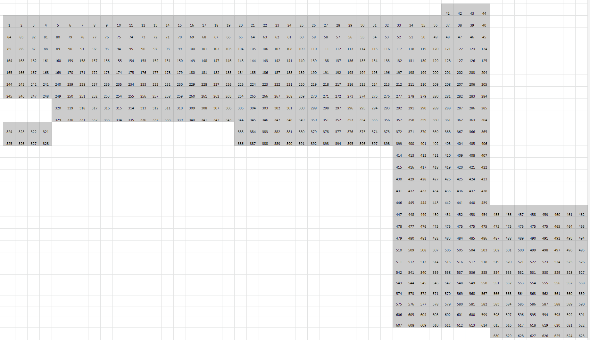
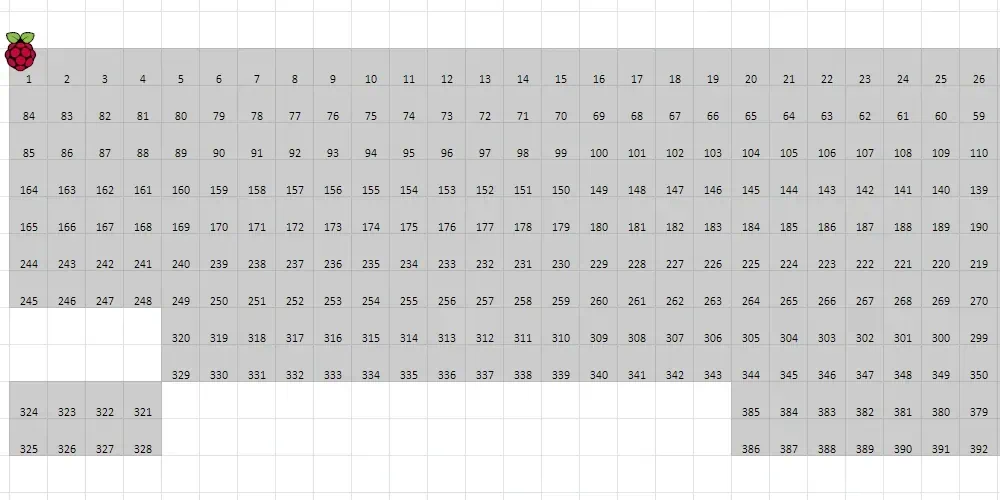
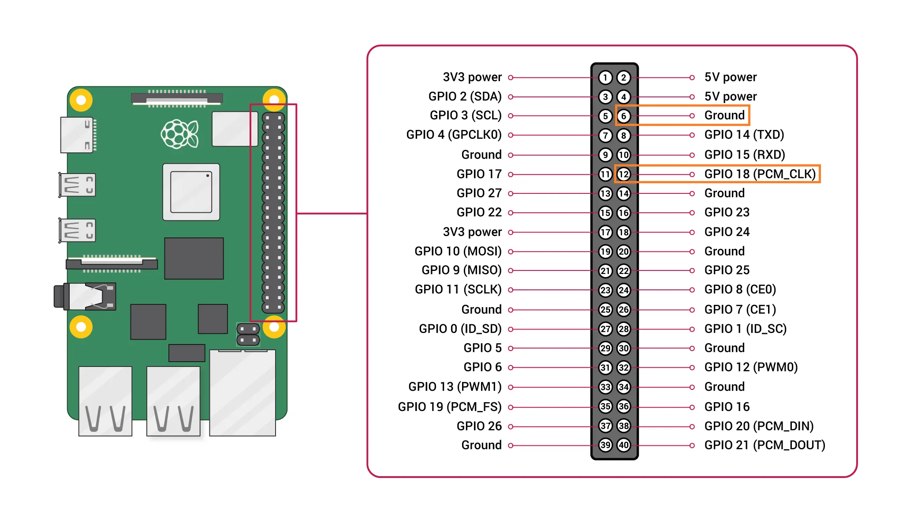

Kistan has a grid of LED pixels spanning across the roof controlled by a single Raspberry Pi. The LEDs are individually addressable and controllable through [LMixer](../software/lmixer).

## Using with LMixer

Each LED is represented as a fixture in LMixer and has 3 (GRB) channels.

Addressing is linear and can be followed like a snake back and forth in the roof. See the picture below for exact fixture IDs.

## Controller

A Raspberry Pi with custom software is used to control all of the LED lights in the roof. It runs custom software that recieves layer data streamed from LMixer over UDP.

### Location

The Pi is located on top of the cable tray in the roof, in the right corner of the wall with the ITKabinet.

### Electrical connection

The Pi is powered with a normal USB power supply and connects to the same networks as the servers with a LAN cable. It is shown in the image below.

import piPhoto from "./images/roof_pi_photo.webp";

<Image
  src={piPhoto}
  alt="Photo of the Raspberry Pi connected to power, LAN and with two wires coming out of its GPIO header"
  className="max-h-120 object-contain"
/>

Two wires are connected to the Pi's GPIO header and go to control the lights. \
The black wire is ground on pin number 6 (GND). \
The green wire is data on pin number 12 (GPIO18). 

## Power distribution

The LEDs in the roof run on 5V power sourced from 3 PSUs. Power is distributed using a set of speaker cables. The PSUs share a common negative rail with a separate cable going between them. The cable between the LEDs is cut between the power distribution lines to separate the positive power rail from the different PSUs.

THe power wiring is shown in the following diagram. 
